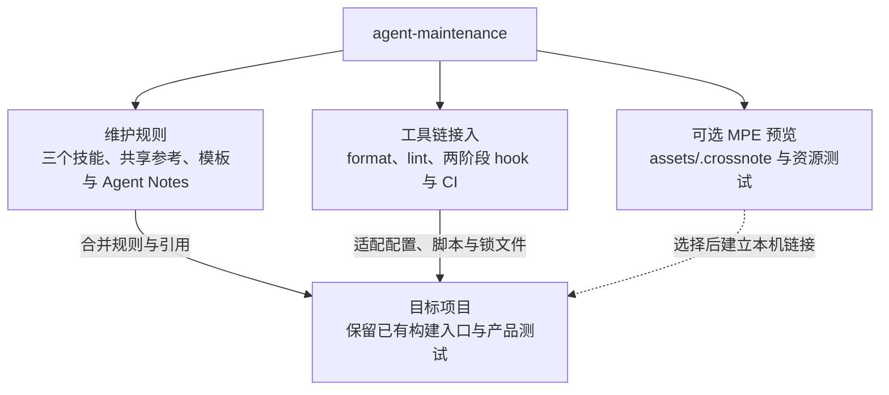
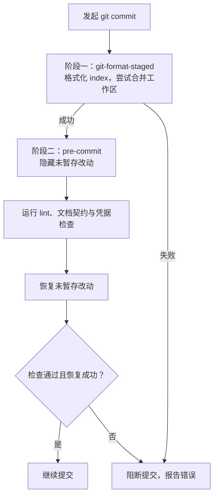

# agent-maintenance：Agent 开发体验与 de-slop

agent-maintenance 为已有 Git 项目提供维护规则、开发工具链和可选 Markdown 预览资源，改善 Agent 开发中的阅读、修改和验证体验。目标是以较低的接入和日常维护成本，减少仓库中的 slop：重复空泛的文字、与实现脱节的说明、无法独立理解的会话残留，以及缺少验证的配置和改动。

维护技能帮助 Agent 判断内容是否准确、必要、放在合适的位置；formatter、lint、hooks 和 CI 检查可机械验证的问题；可选预览资源改善长文档、公式与伪代码的阅读。按需读取参考、复用项目已有入口，并把重复检查交给工具，减少每次任务都要重新解释和人工核对的内容。格式通过只证明对应规则满足，文字含义与产品行为仍需审阅和实际测试。

## 能力与采用方式

按项目需要选择维护技能、[工具链](docs/toolchain.md)和预览资源。目标项目拥有自己的配置、依赖和检查入口：



工具链已验证 Python、Shell、Markdown、YAML、JSON/JSONC、TOML 和 GitHub Actions 的接入。Ruff、Prettier、Taplo 与 shfmt 分别负责对应语法的布局；AutoCorrect 检查正文、代码注释与字符串，自动修复仅用于 Markdown。语义敏感的字符串需审阅并使用有理由的局部豁免，工具职责、扫描范围、版本基线和升级方法见[工具链指南](docs/toolchain.md)。

## 三个技能入口

| 技能                                                                       | 用途                                   |
| -------------------------------------------------------------------------- | -------------------------------------- |
| [maintain-docs](.agents/skills/maintain-docs/SKILL.md)                     | 文档归位、事实核验、实现同步和迁移说明 |
| [maintain-prose](.agents/skills/maintain-prose/SKILL.md)                   | 文字与注释的完整语义、会话残留清理     |
| [maintain-decision-notes](.agents/skills/maintain-decision-notes/SKILL.md) | 决策记录、取代、合并和冻结历史         |

三个技能共用文档、文字与决策维护参考；研究项目可选用问题主报告和支撑报告模板。文档布局、创建门槛与交付步骤见[开发工作流](docs/workflow.md)，目录入口见[文档导航](docs/README.md)。采用时连同技能引用的文件一起复制。产品代码审阅和业务测试沿用目标项目的规范。

`AGENTS.md` 与 `.agents/` 为规则事实源。docs、scripts、.github 与 Notes 的分层入口表达不同区域的职责；不预设产品源码或基准目录。采用时只选择目标项目存在的区域，并修复相对链接。

## 本地准备

需要 Python 3.10+、Node 22.12+ 和 Git。Python 直接依赖钉在 `requirements-dev.txt`，传递依赖与哈希归 `requirements-dev.lock`，npm 工具归 `package.json` 与锁文件。系统工具使用已有包管理器；本机有 Homebrew 时执行：

```sh
brew install autocorrect gitleaks taplo actionlint shfmt shellcheck zsh
python3 -m venv .venv
source .venv/bin/activate
python -m pip install --require-hashes -r requirements-dev.lock
npm ci
python scripts/setup.py
```

setup 只安装本仓 pre-commit/pre-push hooks 与被忽略的 `.claude/skills` 软链；已有自定义 hooksPath 或外来技能目录时拒绝覆盖。不会安装全局技能。hooks 自动使用安装时的 Python 环境；手动运行下面的检查命令前先激活 `.venv`。

## 检查入口

```sh
python scripts/run_checks.py --config scripts/checks.json --mode docs
python scripts/run_checks.py --config scripts/checks.json --mode test
python scripts/run_checks.py --config scripts/checks.json --mode ci
```

docs 检查本地文件与章节锚点、技能结构、篇幅预算、Notes 格式和归档历史；test 运行维护工具行为测试与 MPE 资源测试；ci 汇总文档、测试、格式、lint、中文间距、YAML 注释、Shell、TOML 和 Actions 检查。直接运行历史检查默认以本地 HEAD 为基线；CI 从 PR base 或 push before 获取基线。详细执行关系见[维护流程](docs/pipeline.md)。

格式整理使用 `npm run format`、`ruff format .`、`taplo fmt` 与 `python scripts/check_spacing.py --fix`，最后一项只修 Markdown。检查覆盖代码注释和字符串，排除冻结历史与可选预览载荷。契约检查使用 index 快照；部分暂存与冲突处理见[工具链指南](docs/toolchain.md)。

提交检查按以下顺序执行，暂存区（index）格式化在 pre-commit 隐藏未暂存改动之前完成：



使用 `python scripts/setup.py` 保留两阶段顺序，普通 `pre-commit install` 会覆盖这个入口。formatter 合并冲突会报告 warning 并保留工作区原文，index 可能已格式化；审阅 `git diff` 和 `git diff --cached` 后处理。Markdownlint 修改内容后需审阅并重新暂存。

## 可选 MPE 预览

Markdown Preview Enhanced（MPE）资源归 [assets/.crossnote](assets/.crossnote/README.md)，包含统一主题、五类 Mermaid 着色、图表查看与 SVG／PNG 保存、伪代码渲染和测试。维护 `src/`，构建生成宿主固定文件；目标项目通过显式同步获得独立副本，部署哈希用于识别过期与本地定制。

```sh
npm run build:preview
npm run test:preview
node assets/.crossnote/scripts/sync.cjs --target /absolute/project
node assets/.crossnote/scripts/sync.cjs --target /absolute/project --check
```

旧的 `scripts/crossnote-links.sh` 保留为同步兼容入口。脚本权限、浏览器依赖与验证边界见[预览配置](docs/toolchain.md#可选-mpe-预览)，旧部署按[迁移指南](docs/upgrade-guide/unreleased/crossnote/guide.md)切换。

## 在其他项目采用

给 Agent 的接入提示词（替换两个路径）：

```text
参考 <维护包路径> 的 README 和 docs/toolchain.md，为 <目标仓库路径> 接入适用的维护规则与工具链。先读目标现状，按需采用三个技能及其引用、共享参考、模板、Agent Notes 规则和分层 AGENTS.md；在目标 docs/AGENTS.md 明确实际内容归属，在 docs/README.md 建立阅读入口，按需采用问题报告与支撑材料，不做重复检测；按真实语言范围合并 formatter、lint、两阶段 hooks 和 CI，复用已有构建与检查入口。依赖归目标项目与锁文件，不覆盖现有规则，不复制本包的过程记录。需要 MPE 时再采用预览资源与同步入口。保留来源与许可，修复引用，验证正常与违规输入、真实部分暂存和失败传播。仅配置必要 CI，不新增自动发布；完成后说明改动与未验证项。
```

先核对目标项目已有规则与工具链，按需复制三个技能及其引用的 references、templates 和 notes 规则；不能只复制单个 SKILL.md。保留许可和来源，按真实目录调整入口。

已有 hooks、CI、formatter 和调度器优先复用。`scripts/checks.json` 是本包的检查集合，迁移时逐项核对；`check_docs.py` 中的三技能集合是本仓约束，其他项目应明确自己的集合。产品测试、类型、真实构建与生成器检查需接入目标项目，不能用本包检查代替。

本仓提供检查工作流，不提供部署或发布流程；远端执行与 required checks 需在目标托管平台单独核验。

规则与资源的来源、适配范围和第三方归属见[来源与取舍](来源与取舍.md)，许可见 [LICENSE](LICENSE)。
