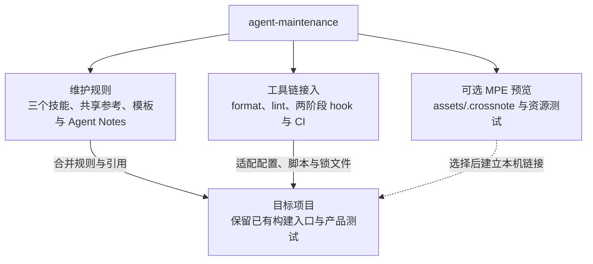
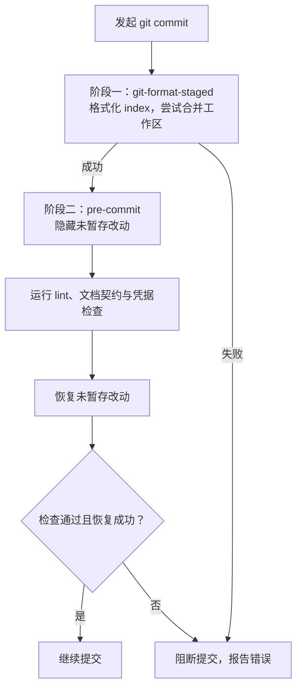

# 通用 Agent 开发维护体系

供已有 Git 项目按需采用的 Agent 维护规则、开发工具链和可选预览资源。文档维护规则从 DeepSeek Harness 提取并中文化，工具链接入与 MPE 资源整合自 setup-toolchain；来源、许可与取舍见[提取说明](来源与取舍.md)和 [LICENSE](LICENSE)。

## 能力与采用方式

本包保留三个维护技能，工具链通过 README 和[工具链指南](docs/toolchain.md)接入，无需安装独立 setup-toolchain skill。目标项目拥有自己的配置、依赖和检查入口，按需采用下面三部分：



工具链已验证 Python、Shell、Markdown、YAML、JSON/JSONC、TOML 和 GitHub Actions 的接入。Ruff、Prettier、Taplo 与 shfmt 分别负责对应语法的布局；AutoCorrect 检查正文、代码注释与字符串，自动修复仅用于 Markdown。语义敏感的字符串需审阅并使用有理由的局部豁免，工具职责、扫描范围、版本基线和升级方法见[工具链指南](docs/toolchain.md)。

## 三个技能入口

| 技能                                                                       | 用途                                   |
| -------------------------------------------------------------------------- | -------------------------------------- |
| [maintain-docs](.agents/skills/maintain-docs/SKILL.md)                     | 文档归位、事实核验、实现同步和迁移说明 |
| [maintain-prose](.agents/skills/maintain-prose/SKILL.md)                   | 文字与注释的完整语义、会话残留清理     |
| [maintain-decision-notes](.agents/skills/maintain-decision-notes/SKILL.md) | 决策记录、取代、合并和冻结历史         |

三个技能共用文档、文字与决策维护参考，采用时连同技能引用的文件一起迁移。通用代码审阅和产品测试策略不在本包范围内。

`AGENTS.md` 与 `.agents/` 为规则事实源。docs、scripts、.github 与 Notes 的分层入口表达不同区域的职责；不预设产品源码或基准目录。采用时只选择目标项目存在的区域，并修复相对链接。

## 本地准备

需要 Python 3.10+、Node 22+ 和 Git。Python 直接依赖钉在 `requirements-dev.txt`，传递依赖与哈希归 `requirements-dev.lock`，npm 工具归 `package.json` 与锁文件。系统工具使用已有包管理器；本机有 Homebrew 时执行：

```sh
brew install autocorrect gitleaks taplo actionlint shfmt shellcheck zsh
python3 -m venv .venv
source .venv/bin/activate
python -m pip install --require-hashes -r requirements-dev.lock
npm ci
python scripts/setup.py
```

setup 只安装本仓 pre-commit/pre-push hooks 与被忽略的 `.claude/skills` 软链；已有自定义 hooksPath 或外来技能目录时拒绝覆盖。不会安装全局技能。后续终端先激活 `.venv`。

## 检查入口

```sh
python scripts/run_checks.py --config scripts/checks.json --mode docs
python scripts/run_checks.py --config scripts/checks.json --mode test
python scripts/run_checks.py --config scripts/checks.json --mode ci
```

docs 检查本地文件链接、技能结构、Notes 格式和归档历史；test 运行维护工具行为测试与 MPE 资源测试；ci 汇总文档、测试、格式、lint、中文间距、YAML 注释、Shell、TOML 和 Actions 检查。直接运行历史检查默认以本地 HEAD 为基线；CI 从 PR base 或 push before 获取基线。详细执行关系见[维护流程](docs/pipeline.md)。

格式整理使用 `npm run format`、`ruff format .`、`taplo fmt` 与 `python scripts/check_spacing.py --fix`，最后一项只修 Markdown。检查覆盖代码注释和字符串，排除冻结历史与可选预览载荷。契约检查使用 index 快照；部分暂存与冲突处理见[工具链指南](docs/toolchain.md)。

提交检查按以下顺序执行，暂存区（index）格式化在 pre-commit 隐藏未暂存改动之前完成：



使用 `python scripts/setup.py` 保留两阶段顺序，普通 `pre-commit install` 会覆盖这个入口。formatter 合并冲突会报告 warning 并保留工作区原文，index 可能已格式化；审阅 `git diff` 和 `git diff --cached` 后处理。Markdownlint 修改内容后需审阅并重新暂存。

## 可选 MPE 预览

Markdown Preview Enhanced（MPE）资源归 [assets/.crossnote](assets/.crossnote/README.md)，包含主题、伪代码渲染、生成器、测试和第三方许可。目标仓库复制链接脚本后建立被忽略的 `.crossnote` 本机目录；配置与资源目录使用软链，两个注入脚本使用同文件系统内的硬链。默认源为 `~/src/agent-maintenance/assets/.crossnote`，可用 `CROSSNOTE_SRC` 覆盖。

资源测试在本包中运行：

```sh
npm run test:preview
node assets/.crossnote/scripts/build-parser.cjs --check
```

旧 setup-toolchain 使用者应先迁移链接脚本、现有软链、硬链和全局 style，再将旧 skill 移出发现目录并保留恢复副本。链接安装、浏览器依赖、工作区信任和验证边界见[预览与迁移说明](docs/toolchain.md#可选-mpe-预览与旧入口迁移)。

## 在其他项目采用

给 agent 的迁移 prompt（替换两个路径）：

```text
参考 <维护包路径> 的 README 和 docs/toolchain.md，为 <目标仓库路径> 接入适用的维护规则与工具链。先读目标现状，按需采用三个技能及其引用、共享参考、模板、Agent Notes 规则和分层 AGENTS.md；按真实语言范围合并 formatter、lint、两阶段 hooks 和 CI，复用已有构建与检查入口。依赖归目标项目与锁文件，不覆盖现有规则，不复制本包的过程记录。需要 MPE 时再采用预览资源与链接脚本。保留来源与许可，修复引用，验证正常与违规输入、真实部分暂存和失败传播。仅配置必要 CI，不新增自动发布；完成后说明改动与未验证项。
```

先核对目标项目已有规则与工具链，按需复制三个技能及其引用的 references、templates 和 notes 规则；不能只复制单个 SKILL.md。保留许可和来源，按真实目录调整入口。

已有 hooks、CI、formatter 和调度器优先复用。`scripts/checks.json` 是本包的检查集合，迁移时逐项核对；`check_docs.py` 中的三技能集合是本仓约束，其他项目应明确自己的集合。产品测试、类型、真实构建与生成器检查需接入目标项目，不能用本包检查代替。

本仓提供检查工作流，不提供部署或发布流程；远端执行与 required checks 需在目标托管平台单独核验。
