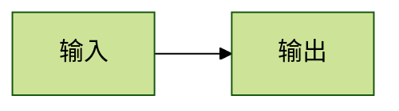

# Crossnote 文档主题与图表

这组资源用于 Markdown Preview Enhanced（MPE）工作区：统一正文、公式、伪代码与 Mermaid 的视觉规则，提供六种纸张配色、系统／编辑器跟随、图表放大和独立 SVG／PNG 保存。Mermaid 继续由 Crossnote 渲染；切换纸张只改变 CSS，不重新排图。HTML 和 Chromium 打印使用同一份文档样式。

安装与迁移见[工具链指南](https://github.com/WncFht/agent-maintenance/blob/main/docs/toolchain.md#可选-mpe-预览)。构建需要本仓锁定的 npm 开发依赖；部署后的资源不需要 Node 包。浏览器增强需要受信任的工作区，以及在 VS Code 用户设置中启用 `markdown-preview-enhanced.enablePreviewScripts`（application 作用域，工作区设置无效）；关闭增强时，原生图表、主题 CSS 与预渲染伪代码仍可显示。

## 使用

外观按钮提供跟随系统、跟随编辑器、暖纸、羊皮纸、雪白、暖黑、One Dark、纯黑。选择保存在当前 webview 的 localStorage；新预览 origin 可能重新从系统外观开始。编辑器跟随依赖 MPE 的 `editor-light`／`editor-dark` 标签，保留 `previewColorScheme: systemColorScheme`。

普通 Mermaid 代码围栏自动采用文档配色。首批着色适配覆盖 flowchart、sequence、state、class、ER；其他图种保留原生颜色。作者的节点 `classDef`／`style` 配色有优先级，标签底色作为文档装饰统一处理。

固定作者主题或需要完整保留原生配色的图，在围栏中加 `{.native}`：

````markdown

````

`.native` 退出文档着色，不更换渲染器。普通图中的 `themeVariables` 可能被文档 CSS 适配覆盖；需要完整自定义色板时使用该入口。方向、布局、形状、字体度量仍由 Mermaid 配置／源码控制；可在图内使用原生 YAML 配置选择 ELK 等能力，不增加私有图表语法。

图表下方提供放大查看、保存 SVG、保存 PNG。查看器支持缩放、适合窗口、拖拽平移和 Esc 关闭；保存从当前 SVG 生成快照，不调用另一个 Mermaid 版本。PNG 为 2 倍尺寸，过大图表会提示保存 SVG。打印时隐藏工具栏和查看器。

### 输出边界

- 主题颜色、字体样式、画布和尺寸写入独立 SVG；支持 SVG 文本和 HTML 标签。已加载网页字体及可访问的图像会嵌入；资源不可读取时显示错误，避免静默丢失。系统字体保留名称，接收机器仍需对应字体，或使用嵌入字体的 PDF。
- 快照针对静态图表；不保留回调交互和脚本。动态嵌入内容、不可读取资源、部分特殊 SVG 消费者需使用文档打印或另行验证。
- 预览增强脚本通过受信任的本地 `head.html` 入口接入，要求 MPE 0.8.40／Crossnote 0.9.42 或兼容宿主。解析器不改写 Markdown，也不依赖 `enableScriptExecution`。导出 HTML 会按宿主策略移除增强脚本，着色与打印仍完整可用。
- 打印采用白纸、黑字和中性边线，独立于屏幕纸张。GFM 图片、Pandoc、Prince 等不同输出链路没有统一配色保证；需要固定图表时先保存 SVG，再作为图片引用。

## 源码与构建

维护 `src/`，不要手改根部带 Generated 标记的文件：

| 来源 | 职责 | 构建目标 |
| --- | --- | --- |
| `src/theme.json` | 槽位、名称、背景／前景、字体 | 外观菜单、槽位 CSS、Mermaid 字体配置 |
| `src/styles/` | 正文、派生变量、打印、图表容器 | `style.less`，完整样式，兼容宿主再次执行 LESS |
| `src/mermaid/paint.css` | 五类图的着色，保留空心关系符号 | `config.js` 的 `themeCSS` |
| `src/config.json` | KaTeX／MathJax 与 Mermaid 固定配置 | `config.js` |
| `src/parser/` | 解析钩子和唯一伪代码纯逻辑 | `parser.js` |
| `src/browser/` | 外观、图表操作与伪代码回退 | `preview.js`、两个延迟模块及外观兼容入口 |

构建用语法树给本包正文选择器添加组件边界，防止段落字号、行高和图片滤镜进入 Mermaid／伪代码；图种着色规则限定到受支持的 SVG 类型，并排除 `.native`。着色规则不修改布局度量。新增图种时添加有范围的规则和行为样例，不为每个图种增加主题状态或渲染队列。

从维护仓根运行：

```sh
npm ci
npm run build:preview
node assets/.crossnote/scripts/build.cjs --check
npm run test:preview
```

构建验证所有输出语法后写入，生成 `bundle.json` 文件哈希清单；同样的来源与依赖生成同样字节。旧 `scripts/build-parser.cjs` 在维护仓中保留为完整构建的兼容入口；目标工作区不再携带生成器。

## 部署与定制

从维护仓同步到目标项目：

```sh
node assets/.crossnote/scripts/sync.cjs --target /absolute/project
node assets/.crossnote/scripts/sync.cjs --target /absolute/project --check
```

目标 `.crossnote` 是独立文件副本，`.xnote-manifest.json` 记录受管文件哈希。`--check` 只读比较当前构建与部署；同步后重新打开预览，使宿主重新加载配置与脚本。维护源不依赖目标工作区的 inode，也不会因目标编辑器回写而改变。

同步前检查全部文件。已部署且未被修改的文件、已知旧版副本、标准 MPE 占位文件可更新；本地分歧会在写入前报告。未知额外文件保留。旧的 canonical 目录软链及硬链可脱离为副本；不接管指向其他来源的目录链接，也不修改全局 Crossnote 配置。

同步在目标项目持有锁，清单最后写入；普通写入失败会回滚。进程被强制终止时可能留下 `.crossnote-sync-*` 备份和 `.crossnote-sync.lock`。确认无同步进程后，保留备份、移走锁，再运行检查／同步；多文件部署不宣称完整原子事务。回滚失败会报告备份位置，不能直接删除恢复材料。

项目定制优先使用图内配置、`.native` 和既有文档样式类。需要改变整套主题时，修改维护源并构建；直接修改受管副本会阻止后续同步。源仓修改不会自动传播到其他工作区。

## 伪代码与兼容资源

`parser.js` 在 QuickJS 沙箱中执行单表达式，不依赖 `require`、`fs` 或 DOM。正常路径在 `onDidParseMarkdown` 将伪代码预渲染为 figure，使预览、HTML 和打印共用结果。浏览器运行时只在预渲染未完成时回退，两个目标使用 `src/parser/pseudocode-core.js` 的同一逻辑。

围栏选项包括 `numbered`／`linenum`、`noend`、`scopelines`、`title=前缀`、`indent=1.5em`、`linepunc=.`、`commentdelim=▷`。部署保留源检查器：

```sh
node .crossnote/scripts/check-pseudocode.cjs
node .crossnote/scripts/check-pseudocode.cjs --staged
```

检查目标是当前 Git 仓，不是脚本所在目录。KaTeX 与 pseudocode.js 的固定来源、许可和校验和见 [vendor](vendor/README.md)。`head.html` 由 `src/head.html` 生成，只引用受宿主路径检查的本地 `preview.js`，不使用内联脚本。该入口装载外观菜单，检测到图表或未预渲染的伪代码时才加载对应模块。宿主拒绝脚本时不会绕过其信任策略。

测试覆盖面与人工验收入口见 [tests](https://github.com/WncFht/agent-maintenance/blob/main/assets/.crossnote/tests/README.md)。
